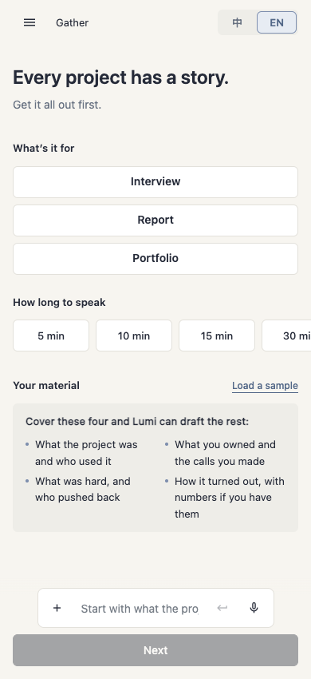
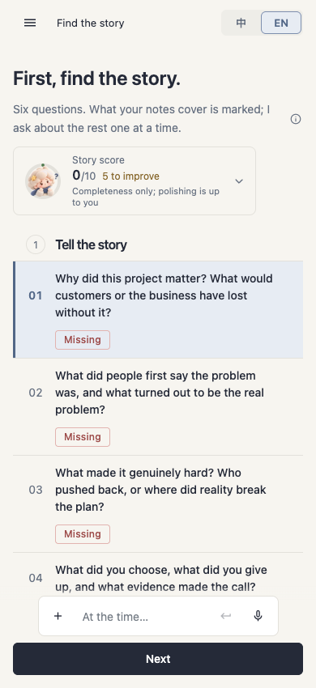
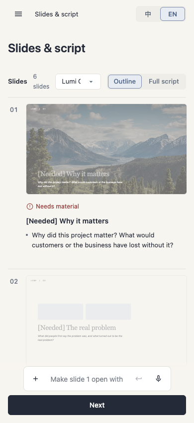

## Scope and evidence

Static review originally covered index.html at 8257d2b7f6b7de543bfb18333ad9b057d3f45a24. Browser verification ran on dda855809a5d7f6078ef6db0891f0401f73dbd93; index.html is unchanged between these commits. This branch builds on PR #4 (harness/template-gaps). No implementation changes or acceptance approval are included.

Measurements: local macOS, headless Chrome 155.0.8059.85, isolated browser context, file URL, light theme, viewport height 850px. Gather was checked at widths 320, 390, 720 and 1280px in Chinese and English. Story and Slides were checked at 390px in English. Screenshots wait for entrance animation completion. Page and language state were set through the prototype's state/render functions; this is a layout inspection, not an end-to-end navigation test. No provider keys or live AI calls were used.

## Findings, highest priority first

| Priority | Finding and implementation source | Expected behavior and source | Browser evidence |
| --- | --- | --- | --- |
| High | Duration controls use four fixed 96px columns plus three 8px gaps (408px total), index.html:781, overriding the earlier mobile rule. | Fit mobile gutters without horizontal overflow; design-system/README.md Layout and tokens.json. Use flexible mobile columns. | Both languages at 320/390px produce document scrollWidth 424px; the last option is clipped at 390px. At 720/1280px document width matches viewport. |
| Medium | Next CTA height is forced to 40px with !important, index.html:759. | Mobile CTA should be 48px, design-system/components/Composer/README.md and design-system/README.md Layout. | Measured 40px at all four widths in both languages. Desktop 40px is recorded only as a measurement, not a separate defect. |
| Medium | Score disclaimer .sc-note is 11px, index.html:1008; rendered by scoreCard(). | 12px muted caption, design-system/components/StoryScore/README.md. | Computed font-size 11px at 390px English. |
| Low | Mobile slide rows remove horizontal padding, index.html:1059. | All numbered lists use 16px inner padding, 24px number column, 12px gap; design-system/README.md Interaction rule 7. | .deck-row computed left/right padding 0px at 390px English; compare the Story and Slides screenshots. |

### Screenshots

Gather, 390 × 850, English: final duration option clips at the right edge; footer CTA is 40px.

Story, 390 × 850, English: score disclaimer and numbered row alignment.

Slides, 390 × 850, English: numbered rows start outside the Story row alignment.

## Conflicting source requirements

Do not silently turn these into implementation defects: design-system/README.md specifies a 64px composer; components/Composer/README.md and tokens.json specify 48px. StoryScore README specifies surface for the open card, while the main README's outlined-card rule specifies paper. The design owner should reconcile these before corresponding corrections.

## Reproduction

Open index.html in a fresh browser context without credentials. Set each viewport listed above, select each language, and inspect Gather. Compare document.documentElement.scrollWidth with innerWidth and read getComputedStyle for .choice-row.compact. Measure .outside-cta with getBoundingClientRect().height. Open Story and read .sc-note fontSize, then Slides and read .deck-row paddingLeft/paddingRight. Capture screenshots after entry animations finish.

## Validation limits and animation dependency

The inspected branch has no package manifest or committed application test suite; scripts/check-docs.sh is the available repository check. No full application-suite pass is claimed. Dark mode, keyboard/accessibility behavior, provider integrations and other page states are outside this round's browser verification.

Lu's wave request requires assets/lumi/source/wave.webp as first/last-frame reference. After git pull origin main on October 22, the remote still reported main at 8257d2b7 and GitHub PR #2 OPEN with mergeCommit null; git ls-tree returned no assets/lumi/source entries. This is a timestamped observation, not a claim about subsequent merge status. Identity review remains pending the exact source and generated preview. Compare face, hair, star clip, blue scarf and clay texture across first/middle/last frames; also inspect hand anatomy, green spill, transparency edges and loop seam. Duration and each output's byte size need separate checks.
