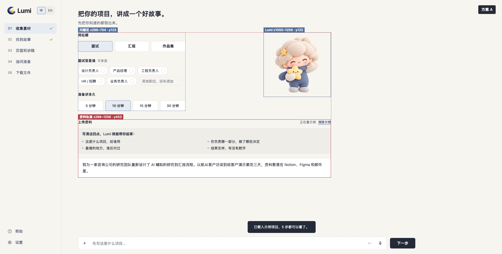
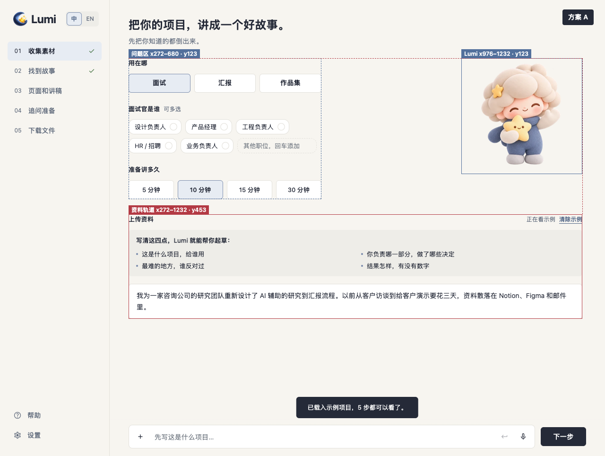
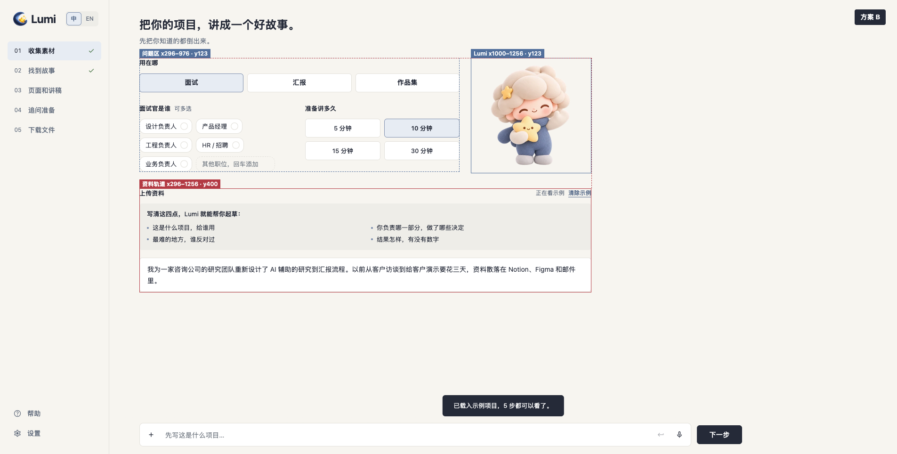
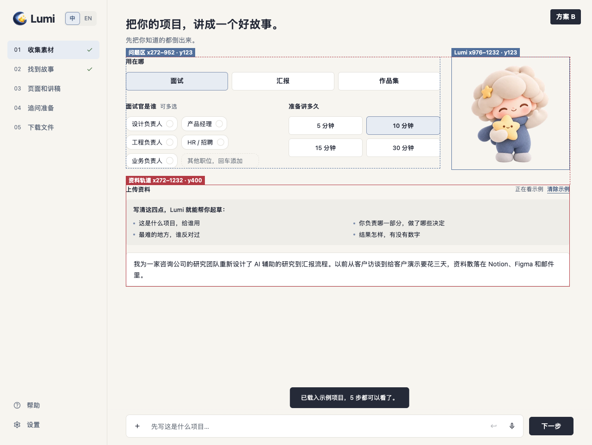
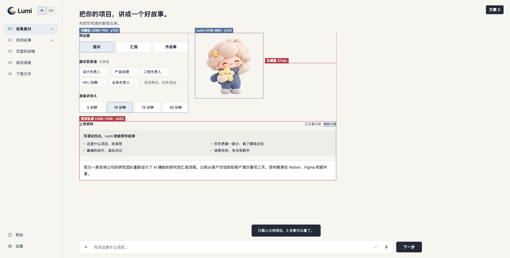
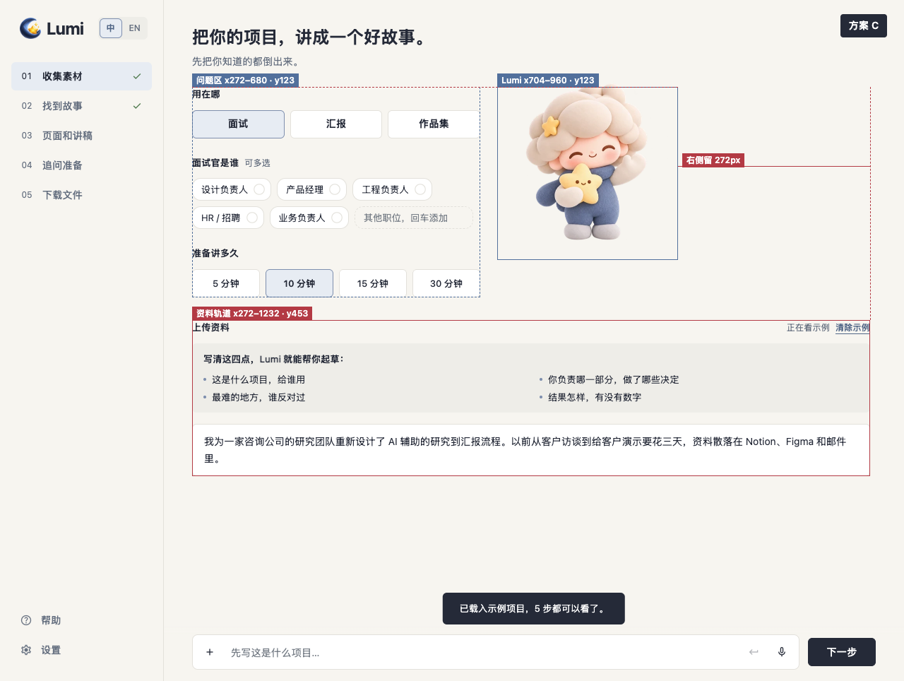

# Handoff evidence

These images support the design-system specifications for Step 1 alignment, StoryScore motion and missing-provider navigation. They are review evidence, not application implementation screenshots.

## Step 1 Lumi alignment

Lu asked to compare several placements because Step 1 has denser setup controls than the other steps: putting Lumi at the far right is consistent across the product, but can leave the left side visually sparse. The three candidates below are rendered from the current 4317 demo with proposal CSS injected; they are design evidence, not application implementation screenshots. All three align Lumi's top to the setup area at y=123 and keep the 960px material rail unchanged.

**Decision:** Lu selected Option A on 2026-10-27 (Buzz event `c0f7e99e`). Option A is the implementation specification in [`design-system/README.md`](../../../design-system/README.md); Options B and C remain below only as decision history.

| Option | Layout | Benefit | Trade-off |
| --- | --- | --- | --- |
| A — rail edge | Keep the existing 408px stacked question block; align Lumi's right edge to the material rail. | Strongest shared right anchor; matches the right-side placement on other steps. | Leaves 296px between the controls and Lumi, so the top area feels split. |
| B — two-column task area | Keep Lumi on the material rail's right edge; widen the questions to 680px, with purpose across the top and audience/time below. | Uses the full left area and keeps Lumi in the product-wide right position; shortens the whole section by 53px. | Changes the scan order and makes time a 2×2 control group. |
| C — adjacent coach | Keep the 408px stacked question block; place Lumi 24px after it. | Preserves the current controls and makes Lumi feel connected to the task. | Leaves 272px at the rail's right side and remains different from other steps. |

### Option A — rail edge

| 1905px | 1280px |
| --- | --- |
|  |  |

At 1905px: questions x=296–704, Lumi x=1000–1256, material x=296–1256. At 1280px: questions x=272–680, Lumi x=976–1232, material x=272–1232.

### Option B — two-column task area

| 1905px | 1280px |
| --- | --- |
|  |  |

At 1905px: questions x=296–976, Lumi x=1000–1256, material x=296–1256. At 1280px: questions x=272–952, Lumi x=976–1232, material x=272–1232. The question-to-Lumi gap is 24px at both widths.

### Option C — adjacent coach

| 1905px | 1280px |
| --- | --- |
|  |  |

At 1905px: questions x=296–704, Lumi x=728–984, material x=296–1256. At 1280px: questions x=272–680, Lumi x=704–960, material x=272–1232. The question-to-Lumi gap is 24px and the remaining rail space is 272px at both widths.

At 390px Lumi remains hidden by the existing ≤720px rule for every option. The single-column content and material area keep the `gutter` edges at x=16 and x=374.

## StoryScore

Current application baseline at commit `31e12e9`, 1280×850 after loading the sample and opening step 2:

[Current StoryScore](https://github.com/lujin88/Lumi-Storytelling/blob/85ce17c3fb26bf64f91b1d97cc3fc7e847e408bc/docs/research/design-handoff/story-score-current.png?raw=true)

Proposed component preview at 900×500. The 48px ring holds a 34px image inside its 36px clear diameter; the preview includes the low-frequency idle and one-shot score-rise reaction:

[StoryScore motion specification](https://github.com/lujin88/Lumi-Storytelling/blob/85ce17c3fb26bf64f91b1d97cc3fc7e847e408bc/docs/research/design-handoff/story-score-spec.png?raw=true)

## Missing connection

Proposed component preview at 900×500 after activating a missing-Gemini prompt and opening setup help. The target row keeps `action-bg`, a 3px `action-ink` leading bar and a visible keyboard focus outline; help remains inside that same region:

[Connection prompt specification](https://github.com/lujin88/Lumi-Storytelling/blob/85ce17c3fb26bf64f91b1d97cc3fc7e847e408bc/docs/research/design-handoff/connection-prompt-spec.png?raw=true)

The cheer change is a timing and playback-state specification in `design-system/motion.md`; its required three-cycle recording belongs to the implementation PR.
