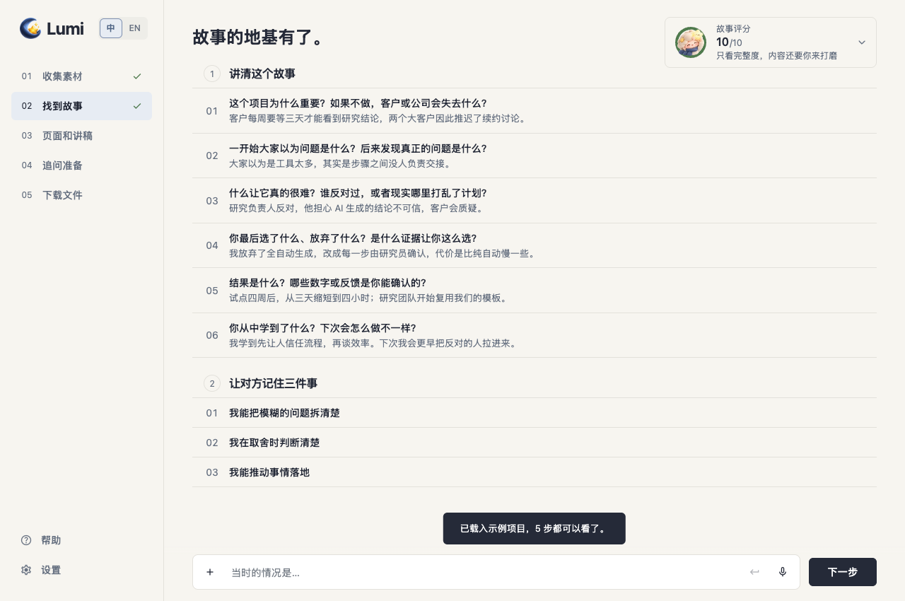
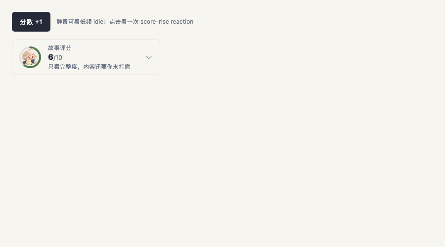
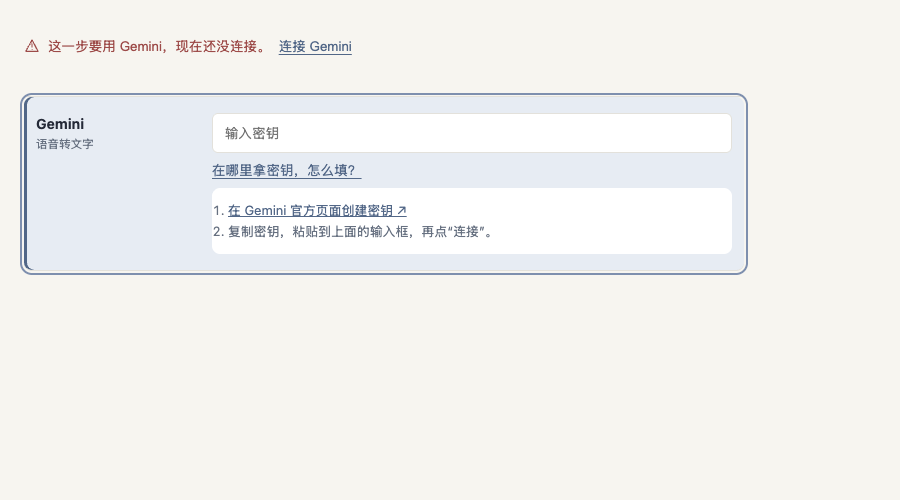

# Handoff evidence

These images support the design-system specifications for StoryScore motion and missing-provider navigation. They are review evidence, not application implementation screenshots.

## StoryScore

Current application baseline at commit `31e12e9`, 1280×850 after loading the sample and opening step 2:

Proposed component preview at 900×500. The 48px ring holds a 34px image inside its 36px clear diameter; the preview includes the low-frequency idle and one-shot score-rise reaction:

## Missing connection

Proposed component preview at 900×500 after activating a missing-Gemini prompt and opening setup help. The target row keeps `action-bg`, a 3px `action-ink` leading bar and a visible keyboard focus outline; help remains inside that same region:

The cheer change is a timing and playback-state specification in `design-system/motion.md`; its required three-cycle recording belongs to the implementation PR.
